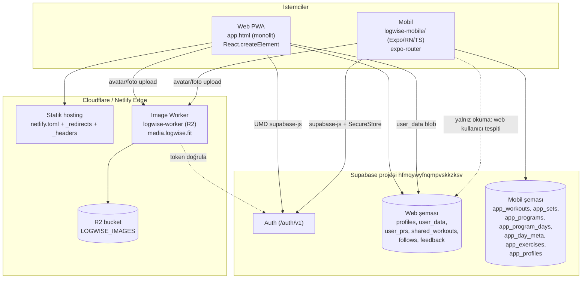
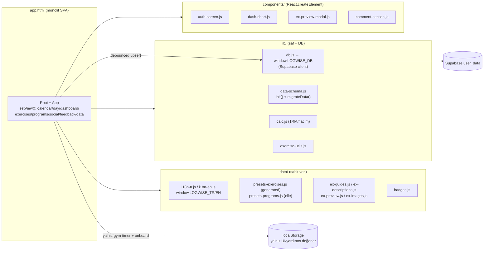
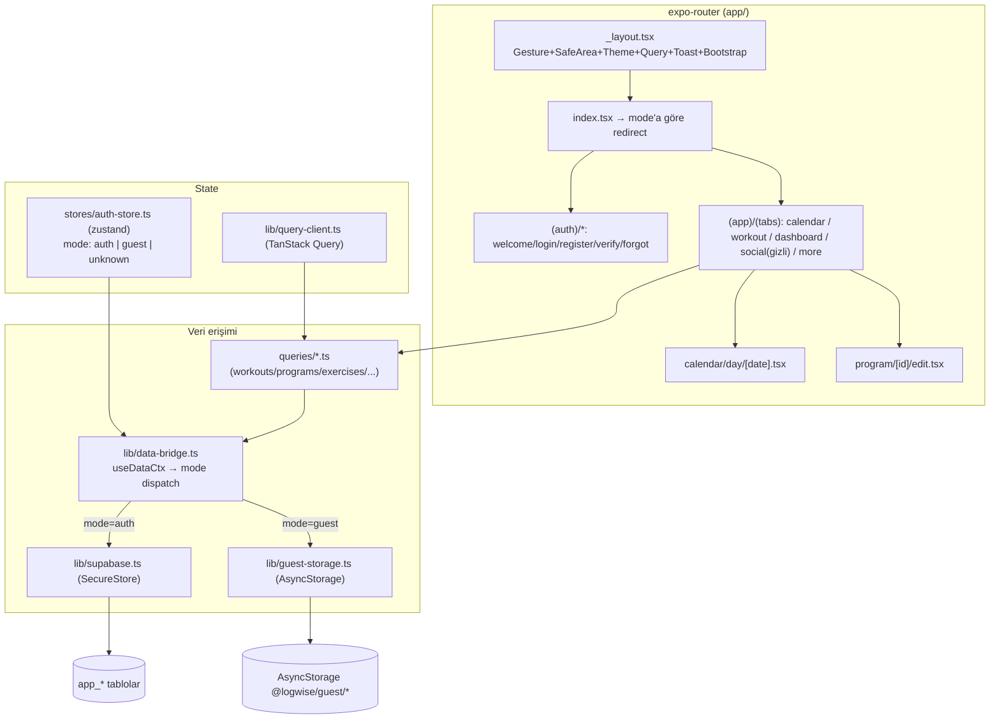
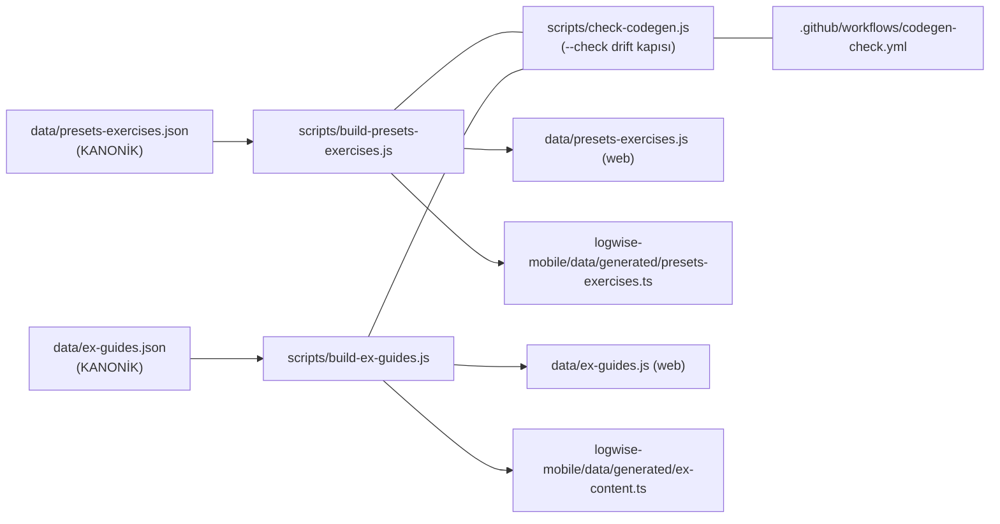

# 02 — SYSTEM ARCHITECTURE

> Etiketler: `DOĞRULANDI` / `ÇIKARIM` / `BELİRSİZ` / `ESKİ OLABİLİR`. Kanıt = dosya + sembol.
> Diyagramlar Mermaid'dir; GitHub/VS Code Mermaid önizlemesinde render olur.

---

## 1. Üst düzey sistem haritası

`DOĞRULANDI` — `lib/db.js` (`SUPABASE_URL`, `sb.from(...)`); `app.html` (`.from("user_data")`);
`logwise-mobile/lib/supabase.ts` + `lib/data-bridge.ts` (`app_*`, `countWebUserData`);
`logwise-worker/src/worker.js` (`verifyWithSupabase`, `env.LOGWISE_IMAGES`); `netlify.toml`.

---

## 2. Web mimarisi (build'siz)

Web'in **derleme adımı yoktur**; tarayıcı dosyaları doğrudan yükler. Tüm yeniden-kullanılabilir
modüller `window.LOGWISE_*` global isim uzayında yaşar ve `app.html` içindeki `<script src>`
sırasıyla yüklenir. `DOĞRULANDI` — `AGENTS.md §3.1`, `app.html` script etiketleri.

**Veri akışı (web):** Kullanıcı verisi tek nesnedir (`lib/data-schema.js` `init()` → 11 anahtar:
`exercises/workouts/programs/dailyPrograms/activeProgram/durations/measurements/dayNotes/
exerciseNotes/programMeta/badges`) ve **yalnız** `user_data` Supabase tablosuna **debounced upsert**
ile yazılır (`app.html` `debouncedSave`); yüklemede `migrateData()` eski şemayı yükseltir.
`localStorage` ana veriyi **tutmaz** — yalnız `gym-timer` + `logwise-onboard-done`. `DOĞRULANDI` —
`lib/data-schema.js`; `app.html` (`.from("user_data")`, `debouncedSave`); `localStorage` anahtarları
yalnız `gym-timer` + `logwise-onboard-done`.

**Veri yolu ayrımı (özet — karıştırma!):**
- Web UI → `debouncedSave` → Supabase `user_data` (ana veri, online). `DOĞRULANDI`.
- Web `localStorage` → yalnız doğrulanmış yardımcı/UI değerleri (`gym-timer`, `logwise-onboard-done`). `DOĞRULANDI`.
- Mobil authenticated → `queries/*` → `data-bridge.ts` → Supabase `app_*`. `DOĞRULANDI`.
- Mobil guest → `data-bridge.ts` → `guest-storage.ts` (AsyncStorage, Supabase YOK). `DOĞRULANDI`.
- Mobil guest→authenticated → `migration.ts` `migrateGuestToAccount` (gerçek veri taşıma). `DOĞRULANDI`.
- Web kullanıcı tespiti → `countWebUserData` = `user_data` **sayımı** (veri aktarımı DEĞİL). `DOĞRULANDI`.

**Routing:** Temiz URL'ler edge'de rewrite edilir (`/app`,`/app/*` → `app.html` 200; `/social`,
`/dashboard`, `/exercises`, `/programs`, `/feedback`, `/data` → `app.html`), React içinde
`setView` ile view değişir. `DOĞRULANDI` — `netlify.toml`, `_redirects`.

---

## 3. Mobil mimari

**Önemli desen — mode-aware dispatch:** Her veri işlemi `useDataCtx()` ile mod (`auth`/`guest`)
çözer; `data-bridge.ts` içindeki her fonksiyon `ctx.mode === 'guest'` ise AsyncStorage'a, değilse
Supabase'e gider. Böylece `queries/*.ts` hook'ları mod kontrolü tekrarlamaz. `DOĞRULANDI` —
`logwise-mobile/lib/data-bridge.ts` (`useDataCtx`, `DataCtx`, tüm `fetch*/create*` fonksiyonları).

**Auth gating:** Root'ta değil, grup layout'larında (`(auth)/_layout.tsx`, `(app)/_layout.tsx`)
`Redirect` ile mod'a göre yapılır. `DOĞRULANDI` — `app/_layout.tsx` ("Auth gating bu seviyede DEĞIL").

**Oturum depolama:** Token'lar `expo-secure-store`'da (chunk'lı, 1800 byte parça), AsyncStorage'a
sızdırılmaz. `DOĞRULANDI` — `lib/supabase.ts` (`secureStorage`, `SECURE_CHUNK_SIZE`).

---

## 4. Ortak veri + codegen mimarisi

- **Tek kaynak → iki çıktı:** Bir generator hem web (`.js`, `window.LOGWISE_*`) hem mobil
  (`generated/*.ts`) üretir; `--check` modunda diske yazmadan farkı denetler. `DOĞRULANDI` —
  `scripts/build-presets-exercises.js` (`WEB_OUTPUT_PATH`, `MOBILE_OUTPUT_PATH`, `CHECK_MODE`).
- **Mobil wrapper'lar:** `logwise-mobile/data/presets-exercises.ts` ve `data/ex-descriptions.ts`
  generated dosyayı tip + yardımcıyla re-export eder (elle veri tutmaz). `DOĞRULANDI` — dosya
  başlıkları ("wrapper", "generated'dan türetilir").

---

## 5. Gerçekten ORTAK vs sadece BENZER (ayrı implementasyon)

| Yapı | Durum | Kanıt |
|---|---|---|
| `data/presets-exercises.json` | **GERÇEK ORTAK** (kanonik → codegen) | `build-presets-exercises.js` `DOĞRULANDI` |
| `data/ex-guides.json` | **GERÇEK ORTAK** (kanonik → codegen) | `build-ex-guides.js` `DOĞRULANDI` |
| `scripts/*` codegen | **GERÇEK ORTAK** (tek araç, iki hedef) | `check-codegen.js` `DOĞRULANDI` |
| `supabase_setup.sql` | **ORTAK dosya, AYRI şemalar** (web + `app_*` birlikte) | `AGENTS.md §4`, dosya `DOĞRULANDI` |
| **presets-programs** | **AYRI IMPLEMENTASYON** (web `.js` elle ↔ mobil `.ts` "port") | mobil başlık "Web ... port"; `check-codegen` kapsamı **dışında** `DOĞRULANDI` |
| **i18n** | **AYRI IMPLEMENTASYON** (web `data/i18n-*.js` ↔ mobil `data/i18n-*.ts`) | iki ayrı format, codegen yok `DOĞRULANDI` |
| **calc / 1RM** | **AYRI** (web `lib/calc.js` ↔ mobil `lib/calc.ts`) | iki dosya `DOĞRULANDI` |
| **exercise resolve** | **AYRI** (web `lib/exercise-utils.js` ↔ mobil `lib/exercise-resolve.ts`) | iki dosya `DOĞRULANDI` |
| **veri erişim katmanı** | **AYRI** (web `lib/db.js`+`app.html` ↔ mobil `data-bridge.ts`) | tablo adları bile farklı `DOĞRULANDI` |

> **Kural:** "Aynı kavram iki platformda da var" ≠ "ortak kod". Ortaklık yalnızca kanonik JSON +
> codegen hattındadır; geri kalan her şey paralel ve elle senkronlanır (ve bir kısmı drift riski
> taşır — bkz. presets-programs, i18n). `DOĞRULANDI`.

---

## 6. Dağıtım sınırları (özet — detay 08'de)

- `.assetsignore` mobil/iç kaynakların Cloudflare web asset deploy'una girmesini engeller.
  `DOĞRULANDI` — `AGENTS.md §3.2`, dosya mevcut.
- `master` = deploy dalı; web `web/work`, mobil `master` worktree'lerinde geliştirilir.
  `DOĞRULANDI` — `AGENTS.md §3.5`.
- SW cache adı her yeni statik dosyada bump edilmeli (`logwise-v49`). `DOĞRULANDI` — `sw.js`,
  `AGENTS.md §3.3`.
