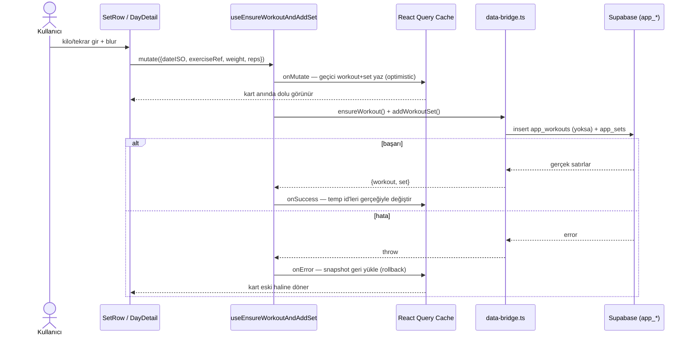
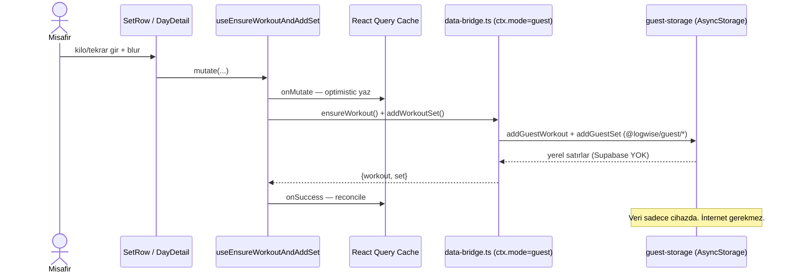

# 05 — CORE USER FLOWS

> Etiketler: `DOĞRULANDI` / `ÇIKARIM` / `BELİRSİZ` / `ESKİ OLABİLİR`. Kanıt = dosya + sembol.
> Akışlar gerçek çağrı zinciri üzerinden izlenir: **ekran → handler → store/hook/query/mutation →
> `data-bridge` → Supabase | guest-storage → cache/UI.** Aksi belirtilmedikçe akışlar **mobil**dir.

---

## 1. Mobil açılış + auth gating
`app/_layout.tsx` (`RootLayout` → `BootstrapBridge` → `useAuthBootstrap`) fontları + Supabase
`getSession()`'ı çözer; biterken `SplashScreen.hideAsync()`. `app/index.tsx` (`RootIndex`)
`useAuthMode()`'a göre: `auth|guest` → `/(app)/calendar`, `unknown` → `/(auth)/welcome`. Gating
grup layout'larında `Redirect` ile (kök değil). `DOĞRULANDI` — `useAuth.ts`, `app/index.tsx`,
`(tabs)/_layout.tsx` (`initialRouteName="calendar"`).
- **Edge:** 5 sn safety timeout → splash kilitlenmesini önler. `DOĞRULANDI` — `useAuth.ts` `safetyTimer`.

## 2. Kayıt / giriş / çıkış / session restore
- **Kayıt:** `queries/auth.ts` `useAuthSignUp` → RPC `check_app_username_available` → `supabase.auth.signUp`
  (email confirmation **kapalı**, session döner) → `app_profiles` upsert (username/display_name).
  `DOĞRULANDI`.
- **Giriş:** `useAuthSignIn` → `signInWithPassword`. **Çıkış:** `useAuthSignOut` → `signOut`.
- **Restore:** `useAuthBootstrap` mount'ta `getSession()` (SecureStore'dan) + `onAuthStateChange`
  aboneliği → `auth-store.setSession`. `DOĞRULANDI`.
- **Edge:** `needsConfirmation = session===null` (Supabase yanlış konfigüre ise). `DOĞRULANDI`.

## 3. Guest moda geçme
Welcome "Misafir Devam Et" → `auth-store` `enterGuest()` (`mode='guest'`) + `@logwise/guest/mode`
bayrağı yazılır; sonraki açılışta `useAuthBootstrap` `readGuestModeFlag()` ile geri yükler.
`DOĞRULANDI` (`auth-store.ts`, `useAuth.ts`); bayrağı yazan ekran satırı bu turda okunmadı → `ÇIKARIM`.

## 4. Takvim / gün seçme
`(tabs)/calendar/index.tsx` → `useWorkoutsByMonth` + `useSetsByMonth` (ay verisi). Güne tap →
`calendar/day/[date].tsx` → `useWorkoutsByDate` + `useSetsByDate`; bunlar ay cache'inden
`initialData` ile **0 network** seed edilir (FAZ 2.5). `DOĞRULANDI` — `queries/workouts.ts`
(`initialData`, `monthKeyForDate`).

## 5. Workout oluşturma (lazy-write)
Kart oluşturma workout satırı yazmaz; **ilk set girilince** `useEnsureWorkoutAndAddSet` →
`ensureWorkout` (yoksa `app_workouts` insert) + `addWorkoutSet`. Optimistic: geçici workout+set
yazılır, `onSuccess`'te temp id'ler gerçeğiyle reconcile. `DOĞRULANDI` — `queries/workouts.ts`,
`data-bridge.ts` `ensureWorkout`.

## 6. Workout güncelleme / silme
- **Sil:** `useDeleteWorkout` → `deleteWorkout` (`app_workouts` delete; `app_sets` **cascade**).
  Optimistic day+month+sets cache'lerinden çıkarır. `DOĞRULANDI` — `supabase_setup.sql` (`app_sets ...
  on delete cascade`).
- **Sıra:** `useReorderDayCards` → `reorderDayCards` (`app_day_meta.card_order` + position).
  Delete+reinsert **YASAK** (set'leri cascade ile silerdi). `DOĞRULANDI` — `data-bridge.ts` yorum.

## 7. Egzersiz ekleme (güne / programa)
- **Güne (manuel):** ilk set ile `useEnsureWorkoutAndAddSet` (bkz. 5).
- **Programa:** `data-bridge.ts` `addProgramDayExercise(s)` → `app_program_days` (position PK çakışması
  için toplu ekleme `addProgramDayExercises`). UI: `components/day/AddExerciseSheet.tsx`. `DOĞRULANDI`.

## 8. Set / tekrar / ağırlık kaydetme
`components/day/SetRow.tsx` blur → `useAddSet` / `useUpdateSet` (pure optimistic, refetch yok).
Köprü: `addWorkoutSet` / `updateSet` → `app_sets`. Guest: `gs.addGuestSet`. `DOĞRULANDI`.

## 9. Custom exercise oluşturma
`createCustomExercise` → `app_exercises` insert (auth) / `@logwise/guest/exercises` (guest);
`categories` default `['Diğer']`. `DOĞRULANDI` — `data-bridge.ts`.

## 10. Program oluşturma / uygulama
- **Preset'ten:** `components/calendar/PresetProgramModal.tsx` → `createProgramFromPreset` →
  diğer programları pasifleştir + `app_programs` insert (`preset_origin`=slug, `activated_at`=now) +
  `app_program_days` toplu insert. **Duplicate guard:** aynı `preset_origin` varsa
  `DuplicateProgramError`. `DOĞRULANDI`.
- **Boş:** `createEmptyProgram` (`activated_at=null`). Düzenleme: `program/[id]/edit.tsx`. `DOĞRULANDI`.

## 11. Program adherence hesabı
`lib/calc.ts` `calcCompliance(program, programDays, workoutDates, todayISO)` → training günleri
(off_days hariç) beklenen vs yapılan distinct tarih oranı; `cycle_type='none'`/`activated_at` yoksa
`null`. `DOĞRULANDI`.

## 12. PR tespiti
- **Web:** `lib/calc.js` `getAllPRs(workouts, exercises)` → maxWeight/maxVolume/est1RM →
  `user_prs` upsert (`app.html line ~1837`); liderlik okuma `line ~1682`. `DOĞRULANDI`.
- **Mobil:** `lib/calc.ts` `calcPRDisplay(sets)` = en yüksek `weight×reps` (kalıcı tablo yok). `DOĞRULANDI`.

## 13. Epley & Brzycki 1RM
**Yalnız web:** `lib/calc.js` `calc1RM` (Epley) + `calcBrzycki`. Mobilde formül **yok**. Ayrıca
statik araç `one-rep-max-calculator.html`. `DOĞRULANDI`.

## 14. Dashboard verisi
`(tabs)/dashboard.tsx` → `queries/dashboard.ts` → `data-bridge.ts` `fetchDashboardSets` (tüm
workouts → tüm set'ler → client-side join) → `lib/dashboard.ts` `computeDashboard`. Saf/test
edilebilir. `DOĞRULANDI`.

## 15. Web kullanıcısının tespiti
Login sonrası (Calendar mount, §3.10) `data-bridge.ts` `countWebUserData` → `user_data`
tablosunda `count` (head:true). `count>0` → kullanıcı web'de veri bırakmış. **Yalnız sayım**,
veri okunmaz/taşınmaz. `DOĞRULANDI`.

## 16. Web→mobil "migration" / karşılama akışı
`countWebUserData>0` + `app_profiles.preferences.seen_web_welcome` yoksa →
`WebUserWelcomeModal.tsx` gösterilir: [Mobil'e Başla] / [Web'e Git] + "bir daha gösterme"
(`seen_web_welcome` yazılır). **Bu bir migration DEĞİL** — sadece bilgilendirme; hiçbir
`user_data` verisi `app_*`'a aktarılmaz. `DOĞRULANDI` — `WebUserWelcomeModal.tsx` (Supabase veri
yazma/okuma yok, yalnız i18n metin + butonlar).

## 17. Guest → authenticated taşıma (GERÇEK migration)
Register (A4) `signUp` success → UI **manuel** `migrateGuestToAccount(userId)` çağırır
(`lib/migration.ts`): tüm guest tabloları oku → UUID remap (`exerciseIdMap/programIdMap/workoutIdMap`,
`remapRef` slug'ı korur) → parent→child sırayla `app_*` batch insert → başarı: `clearAllGuestData` +
`syncProfile` (locale/theme→`app_profiles`); hata: AsyncStorage'a dokunmaz (rollback) + `partialCounts`.
UI overlay: `components/auth/MigrationLoadingOverlay.tsx`. `DOĞRULANDI`.
- **Edge/risk:** Batch tablo bazlı; ortada hata olursa **kısmi insert kalır** (önceki tablolar
  Supabase'e yazıldı) ama guest temizlenmez → retry'de **duplikasyon** olasılığı. `ÇIKARIM` —
  `migration.ts` (insert sırası, `fail` erken çıkış, `clearAllGuestData` yalnız tam başarıda).

## 18. Hata / loading / retry
- Query'ler `retry: 1`, mutations `retry: 0` (`query-client.ts`). `DOĞRULANDI`.
- Mutasyonlar optimistic + `onError` rollback (`queries/workouts.ts`). `DOĞRULANDI`.
- Auth bootstrap 5 sn safety timeout (`useAuth.ts`). `DOĞRULANDI`.
- Web SW: Supabase isteği başarısızsa 503 `{error:'offline'}` (`sw.js`). `DOĞRULANDI`.
- `refetchOnReconnect: true` → ağ dönünce stale query tazelenir; `refetchOnWindowFocus: false`. `DOĞRULANDI`.

---

## Sequence diyagramı A — Authenticated workout kaydetme (mobil)

`DOĞRULANDI` — `queries/workouts.ts` `useEnsureWorkoutAndAddSet`, `data-bridge.ts`.

## Sequence diyagramı B — Guest workout kaydetme (mobil, offline-yerel)

`DOĞRULANDI` — `data-bridge.ts` guest dalları, `guest-storage.ts`.

---

## Her akış nasıl test edilir (öneri)
- **Auth/guest gating:** Uygulamayı temiz state'te aç → Welcome; misafir seç → Calendar; kapat/aç →
  misafir korunur (`@logwise/guest/mode`).
- **Optimistic + rollback:** Uçağa al (offline) → set ekle → kart dolu görünür → online'da reconcile;
  guest'te tamamen yerel.
- **Migration:** Misafirken veri gir → kayıt ol → `MigrationLoadingOverlay` → hesapta `app_*`
  dolu, `@logwise/guest/*` temiz.
- **Web tespiti:** Web'de veri olan hesapla mobil login → karşılama modalı bir kez.
- Mobil testler: `cd logwise-mobile && npm test` (mevcut `__tests__/`).
